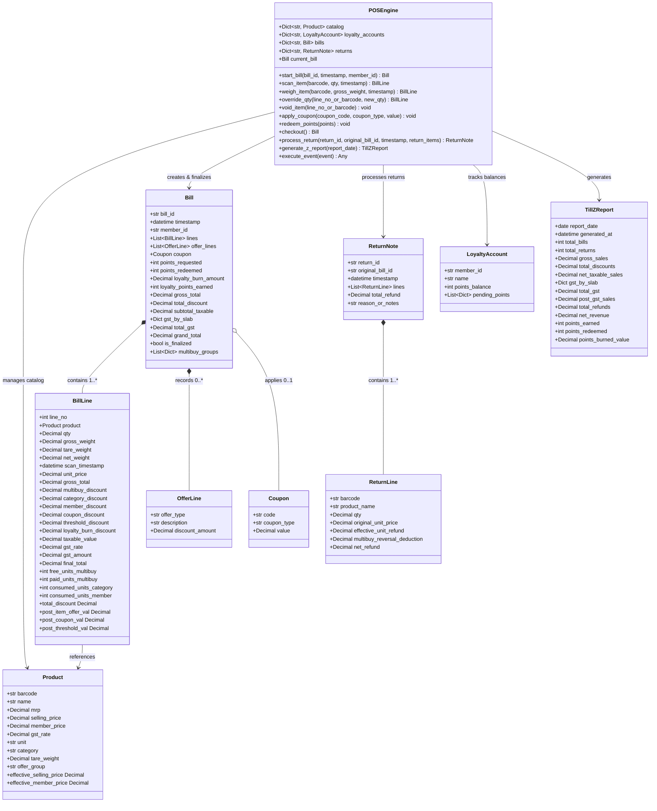
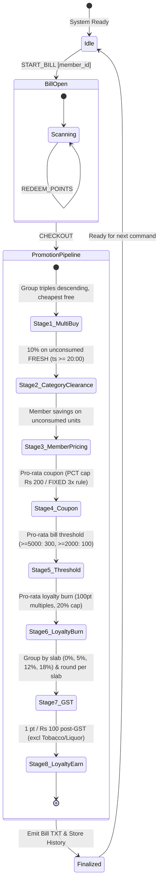
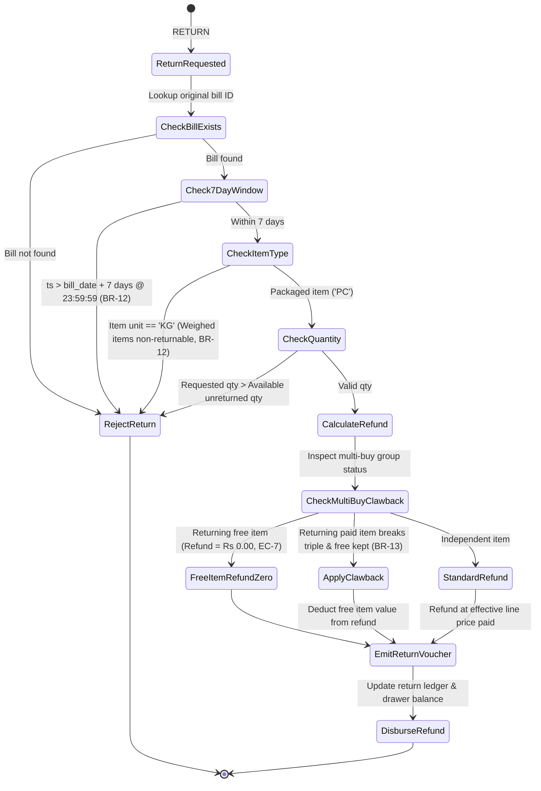

# System Architecture & Technical Design Document

**Capstone Project PS-047: Supermarket POS Billing Engine with Weighted Items, Offer Precedence, and Loyalty**  
**Team IDT002: Aditi Anshu (1AT24CD004) & Aditi Chaudhary (1AT24CD005)**  
**Section: CSDS A | Standard Library Only (Python 3.10+) | Zero External Dependencies | Command-File Driven (No UI)**

---

## 1. System Overview & Core Objectives

The Supermarket Point of Sale (POS) Billing Engine is an enterprise-grade transactional core designed to execute automated, high-precision retail billing without reliance on graphical interfaces or external runtime dependencies. Built strictly on the Python 3.10+ standard library, the engine processes catalog definitions (CSV/JSON) and sequential command files to construct audit-compliant fiscal invoices, enforce strict promotional precedence, apportion bill-level discounts pro-rata, compute Goods and Services Tax (GST) grouped by statutory rate slabs, manage customer loyalty accrual and redemption, and handle post-purchase returns with promotional clawbacks.

### Core Guarantees:
1. **Zero-Float Guarantee:** Floating-point arithmetic (`float`) is strictly barred from all currency, tax, and weight calculations. Every calculation employs `decimal.Decimal` with explicit quantization:
   - Currency: 2 decimal places (`Decimal('0.01')`) using `ROUND_HALF_UP` (nearest paisa).
   - Weights: 3 decimal places (`Decimal('0.001')`) using `ROUND_HALF_UP` (nearest gram).
2. **Deterministic Reproducibility:** Identical inputs of catalog data and command sequences produce bit-exact fiscal outputs and Z-reports regardless of the underlying host operating system.
3. **Audit Trail Integrity:** Every line item retains its complete lineage—from gross price through item-level discounts, coupon apportionment, threshold apportionment, loyalty burn allocation, and intra-slab GST distribution.

---

## 2. Glossary of Domain Terms

| Term | Definition & System Role |
| :--- | :--- |
| **SKU / Barcode** | Stock Keeping Unit identifier; unique alphanumeric or numeric string indexing a product in the catalog. |
| **MRP (Maximum Retail Price)** | Statutory retail price ceiling printed on the packaging. No item may ever be sold above this value (BR-02). |
| **Selling Price (SP)** | Standard retail shelf price offered to regular customers before promotional discounts. |
| **Member Price (MP)** | Preferential price offered to registered loyalty cardholders for specific SKUs (BR-06). |
| **Tare Weight** | Weight of the empty container or packaging material, retrieved from product master (BR-01). |
| **Gross Weight** | Total weight measured by the scale, including product and packaging. |
| **Net Weight** | Billable product weight: $\text{Gross Weight} - \text{Tare Weight}$. Must be $\ge 0.005\text{ kg}$ (BR-01). |
| **Offer Group** | Tag grouping SKUs that participate jointly in promotional deals (e.g., `B2G1_CHOC`). |
| **Multi-Buy (B2G1)** | "Buy 2 Get 1 Free" promotion where the cheapest unit in each triple is awarded free, up to 3 free items (BR-03). |
| **Unit Consumption** | State tracking preventing the same physical item unit from receiving multiple conflicting promotions (BR-05). |
| **Evening Clearance** | 10% markdown applied to `FRESH` category items scanned or weighed at or after 20:00:00 (BR-04). |
| **Pro-Rata Apportionment** | Proportional distribution of bill-level discounts across lines weighted by line value (BR-07, BR-08, BR-11). |
| **Residual Paisa Adjustment** | Allocation of odd fractional rounding cents ($\Delta$) to the highest-value line to preserve exact sums. |
| **Rate Slab** | Statutory GST category (`0%`, `5%`, `12%`, `18%`). Rounding is performed per slab, not per item (BR-09). |
| **CGST & SGST** | Central GST and State GST. Each constitutes exactly 50% of the slab tax, rounded half-up to the paisa. |
| **Loyalty Earn** | Accrual of reward points at 1 point per Rs 100 post-GST value, excluding tobacco and alcohol (BR-10). |
| **Loyalty Burn** | Redemption of points at Rs 0.25/pt, in multiples of 100 points, capped at 20% of bill subtotal (BR-11). |
| **Promotional Clawback** | Recovery of free item value when a customer returns paid items from a multi-buy triple (BR-13). |
| **Till Z-Report** | End-of-day fiscal reconciliation report balancing gross sales, discounts, taxes, returns, and net cash. |

---

## 3. High-Level Architecture & Module Breakdown

The billing engine follows a clean domain-driven architecture separated into models, parsing, transactional logic, and formatting:

```
Supermarket-POS/
├── src/
│   ├── __init__.py           # Package namespace, version, and author metadata
│   ├── models.py             # Pure domain entities, dataclasses, and Decimal quantization
│   ├── parser.py             # CSV/JSON catalog loader and command stream lexer
│   ├── engine.py             # Transaction orchestrator implementing BR-01 through BR-13
│   └── formatter.py          # Plain-text ASCII fiscal invoice, return note, & Z-report renderers
├── data/
│   ├── products.csv          # Master catalog dataset covering all categories and units
│   └── commands.txt          # POS batch command file exercising normal and edge cases
├── tests/
│   ├── __init__.py
│   └── test_pos_engine.py    # Unittest suite validating BR-01..BR-13 and Edge Cases 1..8
├── docs/
│   ├── DESIGN.md             # This comprehensive architecture and design specification
│   └── DECISION_LOG.md       # Decision register and edge-case resolution logs
├── output/                   # Directory receiving generated bills, return notes, and Z-reports
├── main.py                   # CLI entry point supporting --products, --commands, --output
├── .gitignore                # Git repository hygiene ignoring caches and bytecode
└── README.md                 # Complete user, developer, and tester documentation
```

### Module Responsibilities:

1. **`src/models.py`**:
   - `Product`: Catalog master entity with properties `effective_selling_price` and `effective_member_price` enforcing MRP ceiling.
   - `BillLine`: Line item holding quantity/weight, base pricing, all discount tiers, taxable value, intra-slab tax, and multi-buy state tracking.
   - `OfferLine`: Audit descriptor of an applied promotional discount.
   - `Coupon`: Container for validated coupon rules (`PCT` vs `FIXED`).
   - `Bill`: Root transactional aggregate root managing line items, coupons, loyalty requests, rate-slab tax maps, and finalized state.
   - `ReturnLine` & `ReturnNote`: Audit voucher tracking refunded items, effective unit prices, and promotional clawbacks.
   - `LoyaltyAccount`: Customer loyalty point ledger tracking active balance and 7-day pending accruals.
   - `TillZReport`: Fiscal till balance sheet consolidating gross sales, total discounts, net taxable sales, rate-slab taxes, refunds, and net drawer revenue.

2. **`src/parser.py`**:
   - `load_products_csv` & `load_products_json`: Robust catalog deserialization with header trimming, GST rate normalization, unit normalization, and Decimal conversion.
   - `parse_command_line` & `parse_command_file`: Command interpreter parsing tokens into structured `ScanEvent` objects, propagating bill timestamp contexts.

3. **`src/engine.py`**:
   - `POSEngine`: Stateful till controller maintaining active bill context, product registry, customer loyalty database, and historical transaction log.
   - Implements the 8-stage checkout promotion pipeline, return window validator, and Z-report aggregator.

4. **`src/formatter.py`**:
   - `format_bill`: Renders structured plain-text retail invoices showing line-item details, applied offers, rate-slab GST tables, loyalty accrual/burn, and return policies.
   - `format_return_note`: Renders refund vouchers detailing unit prices paid, multi-buy clawback deductions, and net refund disbursement.
   - `format_z_report`: Renders end-of-day till reconciliation statements balancing gross revenue, discounts, slab taxes, refunds, and net till totals.

---

## 4. Class Diagram



---

## 5. State Machine & Transaction Lifecycle

### 5.1 Bill Transaction Lifecycle



### 5.2 Return Lifecycle



---

## 6. Business-Rule Register (BR-01 through BR-13)

| Rule ID | Rule Name | Detailed Specification | Inputs / Constraints | Output / System Action | Test Reference |
| :--- | :--- | :--- | :--- | :--- | :--- |
| **BR-01** | Weighed Items & Scale Tare | Net weight is computed as gross weight minus packaging tare weight from master (default 0). Unit price is per kg, rounded half-up to nearest paisa (2 decimals). Minimum legal net weight is 0.005 kg. | `gross_weight`, `tare_weight`, `selling_price`, `mrp`. Net weight $< 0.005\text{ kg}$ is rejected. | Rejects with `ValueError` if $< 0.005\text{ kg}$. Line total: `quantize_currency(net_wt * unit_price)`. | `test_br01_weighed_items_tare_subtraction`, `test_edge_case_1_net_weight_boundary` |
| **BR-02** | MRP Price Ceiling | No item may ever be billed above its Maximum Retail Price (MRP). If selling price or member price exceeds MRP, it is capped at MRP. | `selling_price`, `member_price`, `mrp`. | Effective unit price = $\min(\text{price}, \text{MRP})$. Prevents legal price infractions. | `test_br02_mrp_ceiling_enforcement`, `test_edge_case_2_member_price_above_mrp` |
| **BR-03** | Multi-Buy 'Buy 2 Get 1 Free' | For tagged SKUs in the same offer group, each triple of 3 units earns the cheapest unit 100% free. Units are sorted descending by unit price. Maximum 3 free items per bill per offer group. | `offer_group`, discrete units in cart. | Cheapest item in each triple discounted by 100% of its unit price. Triples marked as consumed. | `test_br03_multibuy_buy2_get1_free`, `test_edge_case_3_four_items_different_prices_multibuy` |
| **BR-04** | Category Evening Clearance | 10% discount on items in category `FRESH` scanned or weighed at or after 20:00:00 (`time >= 20:00:00`). Applies only to units NOT consumed by Multi-Buy. | `category == 'FRESH'`, `scan_timestamp`. | 10% discount on unconsumed gross value of line: `quantize_currency(val * 0.10)`. | `test_br04_category_discount_evening_clearance`, `test_edge_case_4_evening_clearance_exactly_20_00` |
| **BR-05** | Strict Offer Precedence | Promotions must be evaluated in exact sequence: (1) Multi-Buy $\to$ (2) Category Discount $\to$ (3) Member Pricing $\to$ (4) Coupon $\to$ (5) Bill-Level Threshold. Prior promotions consume physical units. | Cart state, promotional configuration. | Physical units consumed in earlier stages cannot participate in subsequent item discounts. | `test_br05_offer_precedence_exclusion` |
| **BR-06** | Member Pricing | Registered loyalty cardholders receive `member_price` on tagged SKUs on units not consumed by Multi-Buy or Category discount. Capped at MRP (BR-02). | `member_id`, `member_price`, `unit_price`. | Line discount = $(\text{unit\_price} - \text{member\_price}) \times \text{unconsumed\_units}$. | `test_br06_member_pricing_on_unconsumed_items` |
| **BR-07** | Coupon Discount | Maximum 1 coupon per bill applied to subtotal post-item-offers. `PCT`: $X\%$ off, capped at Rs 200.00. `FIXED`: Rs $Y$ off, valid ONLY if subtotal $\ge 3Y$ (rejected otherwise). Apportioned pro-rata. | `coupon_type`, `coupon_value`, post-item-offer subtotal. | Pro-rata distributed discount across all positive lines; odd paisa adjusted on largest line. | `test_br07_coupon_percentage_and_fixed` |
| **BR-08** | Bill-Level Threshold Discount | Evaluated on subtotal after coupon: $\ge \text{Rs } 5,000.00 \to \text{Rs } 300.00$ off; $\ge \text{Rs } 2,000.00 \to \text{Rs } 100.00$ off. Apportioned pro-rata. | Subtotal post-coupon. | Threshold discount apportioned pro-rata; largest line absorbs residual paisa. | `test_br08_bill_threshold_discount`, `test_edge_case_5_subtotal_exactly_2000_threshold` |
| **BR-09** | Rate-Slab GST Computation | GST is calculated on final post-discount, post-loyalty-burn taxable values. Line values are grouped by rate slab (`0%`, `5%`, `12%`, `18%`) and rounded per slab (ROUND_HALF_UP), not per item. | Line taxable values, `gst_rate`. | Slab tax computed; CGST = $\text{round}(\text{tax}/2)$, SGST = $\text{tax} - \text{CGST}$. Allocated to lines for refund tracking. | `test_br09_gst_rate_slab_grouping_and_rounding` |
| **BR-10** | Loyalty Accrual (Earn) | Earn 1 point per full Rs 100 of post-GST bill value, excluding `TOBACCO` and `LIQUOR` categories. Points remain `PENDING` for 7 days. | Member ID, post-GST line totals, category. | $\lfloor \text{eligible\_total} / 100 \rfloor$ points credited to pending account queue. | `test_br10_loyalty_earn_and_exclusions` |
| **BR-11** | Loyalty Redemption (Burn) | 1 point = Rs 0.25. Allowed ONLY in multiples of 100 points. Capped at 20% of post-threshold bill subtotal. Applied before GST and apportioned pro-rata. | `points_to_redeem`, member balance, subtotal post-threshold. | Deducts points from balance; apportions discount pro-rata before GST computation. Blocked if 100 pts $> 20\%$. | `test_br11_loyalty_burn_rules`, `test_edge_case_6_loyalty_burn_20_percent_cap_blocked` |
| **BR-12** | Return Window & Weighed Exclusion | Returns accepted within 7 days against original bill ($\le \text{bill date} + 7\text{ days}$ up to 23:59:59). Weighed items (`KG`) are strictly non-returnable. Refund equals item's effective final price. | `original_bill_id`, return timestamp, items dictionary. | Rejects return if past deadline or if weighed item. Valid returns refunded at post-discount post-tax price paid. | `test_br12_returns_and_window`, `test_edge_case_8_return_day_7_closing_vs_day_8` |
| **BR-13** | Multi-Buy Return Clawback | If returning paid items breaks a multi-buy group of 3 while the free item was kept, deduct the free item's original value from the refund. Returning the free item yields Rs 0.00 refund. | Bill's `multibuy_groups` ledger, return items. | Computes net refund = $\max(0, \text{gross refund} - \text{free item value})$. Free item return yields 0 refund. | `test_br13_multibuy_return_reversal`, `test_edge_case_7_return_free_item_multibuy` |

---

## 7. Mathematical Formulations & Algorithms

### 7.1 Weighed Items Net Calculation (BR-01)
For a scale scan with gross weight $W_{\text{gross}}$, tare weight $W_{\text{tare}}$, and product unit price $P$:
$$W_{\text{net}} = \text{quantize\_weight}(W_{\text{gross}} - W_{\text{tare}})$$
$$\text{Precondition: } W_{\text{net}} \ge 0.005 \implies \text{Valid, else raise } \text{ValueError}$$
$$\text{Line Gross Total} = \text{quantize\_currency}(W_{\text{net}} \times P)$$

### 7.2 Multi-Buy Sorting & Greedy Triple Partitioning (BR-03)
Let $U = \{u_1, u_2, \dots, u_N\}$ be the set of discrete unit items belonging to offer group $G$. The items are sorted in descending order of their effective unit price:
$$P(u_1) \ge P(u_2) \ge \dots \ge P(u_N)$$
The number of valid multi-buy promotional triples is:
$$K = \min\left( \left\lfloor \frac{N}{3} \right\rfloor, 3 \right)$$
For each triple index $k \in \{0, \dots, K-1\}$:
$$\text{Paid Units}_k = \{u_{3k}, u_{3k+1}\}$$
$$\text{Free Unit}_k = u_{3k+2} \quad (\text{cheapest unit in triple})$$
$$\text{Multi-Buy Discount}_k = P(u_{3k+2})$$
Any remaining units $u_{3K}, \dots, u_N$ cannot form a complete triple, receive 0 multi-buy discount, and remain completely unconsumed for subsequent promotions.

### 7.3 Two-Pass Pro-Rata Apportionment with Residual Drift Correction (BR-07, BR-08, BR-11)
When distributing a bill-level discount $D_{\text{total}}$ across $M$ eligible lines with base values $V_1, V_2, \dots, V_M$ having total base $V_{\text{sum}} = \sum_{i=1}^M V_i > 0$:

**Pass 1 (Proportional Quantization):**
For each line $i \in \{1, \dots, M\}$:
$$S_i = \text{quantize\_currency}\left( \frac{V_i}{V_{\text{sum}}} \times D_{\text{total}} \right)$$

**Pass 2 (Residual Discrepancy Resolution):**
The sum of rounded shares may diverge from $D_{\text{total}}$ by several paise due to independent half-up rounding. The rounding discrepancy is:
$$\Delta = D_{\text{total}} - \sum_{i=1}^M S_i$$
Let $j = \arg\max_{i} (V_i)$ be the index of the line item having the maximum base value. The residual drift is added directly to line $j$:
$$S_j \leftarrow S_j + \Delta$$
This guarantees the exact conservation law:
$$\sum_{i=1}^M S_i \equiv D_{\text{total}} \quad (\text{accurate to the exact paisa, zero penny-drift})$$

### 7.4 Statutory Rate-Slab GST Rounding (BR-09)
Let $\mathcal{L}_R$ be the set of bill lines subject to GST rate slab $R \in \{0, 5, 12, 18\}$.
1. Aggregate the net taxable base for slab $R$:
   $$T_R = \sum_{l \in \mathcal{L}_R} \text{TaxableValue}(l)$$
2. Compute consolidated slab tax rounded half-up:
   $$\text{GST}_R = \text{quantize\_currency}\left( T_R \times \frac{R}{100} \right)$$
3. Compute split central and state taxes:
   $$\text{CGST}_R = \text{quantize\_currency}\left( \frac{\text{GST}_R}{2} \right)$$
   $$\text{SGST}_R = \text{GST}_R - \text{CGST}_R$$
4. Allocate slab tax to individual lines proportionally (with residual adjustment on largest line) to ensure line-level refundability during partial returns.

### 7.5 Loyalty Burn Cap Calculation (BR-11)
For a member requesting redemption of $P_{\text{req}}$ points against a post-threshold subtotal $S_{\text{thresh}}$:
$$\text{Max Allowed Burn Amount} = \text{quantize\_currency}(S_{\text{thresh}} \times 0.20)$$
$$\text{Max 100-pt Multiples} = \left\lfloor \frac{\text{Max Allowed Burn Amount}}{25.00} \right\rfloor$$
$$P_{\text{max\_burnable}} = \text{Max 100-pt Multiples} \times 100$$
$$P_{\text{effective}} = \min(P_{\text{req}}, P_{\text{max\_burnable}}, \text{Member Balance})$$
$$P_{\text{final}} = \left\lfloor \frac{P_{\text{effective}}}{100} \right\rfloor \times 100$$
$$\text{Burn Discount} = \text{quantize\_currency}(P_{\text{final}} \times 0.25)$$

### 7.6 Multi-Buy Return Clawback Algebra (BR-13)
When a return request arrives for an item with barcode $B$ and quantity $Q$ from a bill with multi-buy group $\{u_{\text{paid1}}, u_{\text{paid2}}, u_{\text{free}}\}$:
- **Case 1: Customer returns the promotional free item ($B = u_{\text{free}}$):**
  $$\text{Effective Unit Refund} = \text{Rs } 0.00$$
  $$\text{Net Refund} = \text{Rs } 0.00$$
- **Case 2: Customer returns a paid item ($B \in \{u_{\text{paid1}}, u_{\text{paid2}}\}$):**
  If the group of 3 is broken and the free item was retained by the customer:
  $$\text{Gross Refund} = \text{Effective Line Paid Value of Returned Units}$$
  $$\text{Clawback Deduction} = \text{Unit Price of } u_{\text{free}}$$
  $$\text{Net Refund} = \max(\text{Rs } 0.00, \text{Gross Refund} - \text{Clawback Deduction})$$
  $$\text{Reversal Applied Flag} \leftarrow \text{True (ensures clawback is deducted at most once)}$$

### 7.7 Till Z-Report Invariant Accounting Identities
At any given business date, the daily Z-report maintains strict fiscal conservation:
$$\text{Gross Sales} - \text{Total Discounts} = \text{Net Taxable Sales}$$
$$\text{Net Taxable Sales} + \text{Total GST Collected} = \text{Post-GST Sales}$$
$$\text{Cash Drawer Net Revenue} = \text{Post-GST Sales} - \text{Total Customer Refunds}$$
$$\sum_{R} \text{Slab Tax}_R \equiv \text{Total GST Collected}$$

---

## 8. Explicit Edge Cases Verification Matrix

| Edge Case | Description | Boundary Conditions | Expected Behavior | Automated Test Reference |
| :---: | :--- | :--- | :--- | :--- |
| **EC-1** | Net weight scale boundary | Gross = 0.055 kg, Tare = 0.050 kg $\to$ Net = 0.005 kg.<br>Gross = 0.054 kg, Tare = 0.050 kg $\to$ Net = 0.004 kg. | Net = 0.005 kg is accepted.<br>Net = 0.004 kg is rejected with `ValueError`. | `test_edge_case_1_net_weight_boundary` |
| **EC-2** | Member price configured above MRP | MRP = 100.00, SP = 110.00, MP = 120.00. | Effective unit price capped at MRP = 100.00. Member charged 100.00. | `test_edge_case_2_member_price_above_mrp` |
| **EC-3** | 4 items of different prices in multi-buy | Items priced at Rs 100, 80, 60, 40 in offer group `B2G1_CHOC`. | Sorted: [100, 80, 60, 40]. First triple (100, 80, 60) gives 60 free. 40 is paid full price. | `test_edge_case_3_four_items_different_prices_multibuy` |
| **EC-4** | Evening clearance at boundary | FRESH item scanned at exactly 20:00:00 vs 19:59:59. | 20:00:00 receives 10% discount.<br>19:59:59 receives 0% discount. | `test_edge_case_4_evening_clearance_exactly_20_00` |
| **EC-5** | Bill subtotal of exactly Rs 2,000 | Subtotal after coupon = Rs 2,000.00. | Triggers Rs 100.00 threshold discount (threshold condition $\ge 2000.00$). | `test_edge_case_5_subtotal_exactly_2000_threshold` |
| **EC-6** | Loyalty burn 20% cap blocked on small bill | Bill subtotal = Rs 100.00. Customer requests 100 points (Rs 25.00). | 20% cap = Rs 20.00. Since even 100 pts (Rs 25.00) exceeds cap, 0 points redeemed. | `test_edge_case_6_loyalty_burn_20_percent_cap_blocked` |
| **EC-7** | Return of free item in multi-buy | Customer returns the promotional free item from a B2G1 deal. | Refund is strictly Rs 0.00; no clawback deducted. | `test_edge_case_7_return_free_item_multibuy` |
| **EC-8** | Return on Day 7 closing vs Day 8 opening | Bill on 2026-11-01 10:00:00.<br>Return at Day 7 23:59:59 vs Day 8 00:00:00. | Day 7 at 23:59:59 accepted.<br>Day 8 at 00:00:00 rejected with `ValueError`. | `test_edge_case_8_return_day_7_closing_vs_day_8` |

---

## 9. Verification & Test Architecture

The system test harness is built on Python's native `unittest` framework:
- **No external runners:** Runs directly with `python -m unittest discover -s tests -v`.
- **Exhaustive coverage:** 23 dedicated unit tests validating all 13 business rules, all 8 edge cases, quantity override operations, void operations, and till reconciliation.
- **Continuous Integration Ready:** Clean zero-exit status ensures flawless integration with standard CI/CD and submission verification pipelines.
